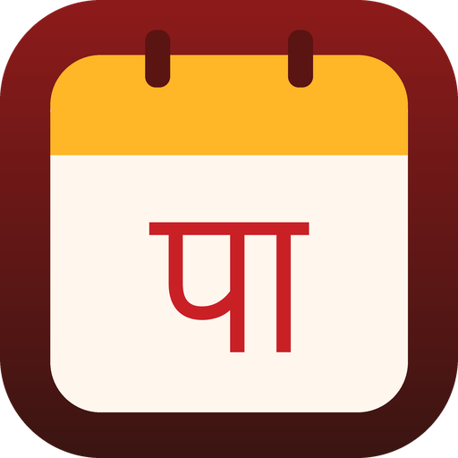

# Yogi Patro 🪔

**A clean Nepali calendar (Bikram Sambat).** No ads, no account, works fully offline. Your reminders stay on your phone.

## Features
* **🪔 Today**
  * Today's BS date in Nepali or English, with the weekday and the AD date.
  * Tithi with paksha and lunar month, e.g. *मार्ग शुक्ल पक्ष तृतीया*.
  * Sunrise and sunset for your city.
  * Today's festival, your next reminders, and the next 10 festivals with a countdown.
* **🗓 Calendar**
  * Each BS month as a grid, with the AD day in each cell, a short tithi, Purnima and Aunsi in gold, and festival dots.
  * Saturdays and holidays in red.
  * Swipe sideways to change the month. Tap a day for its tithi, sunrise, festivals, and to add a reminder.
* **🔁 Converter**: BS → AD, AD → BS, and your exact age from a BS birth date.
* **🎂 Reminders**
  * Birthdays, anniversaries and shraddha by **BS date**, repeated every year, with the age.
  * A notification at 7 am on the day, plus a "tomorrow" note the day before.
* **Festivals**: Dashain (Ghatasthapana to Kojagrat), Tihar (Kaag, Kukur, Laxmi Puja, Govardhan, Bhai Tika), Chhath, Teej, Janai Purnima, Gai Jatra, Janmashtami, Shivaratri, Holi, Buddha Jayanti, Ram Navami, the Lhosars, Mother's and Father's Day, national days and more.
* **3 home-screen widgets** (they work with Yogi Launcher too):
  * a small date
  * today with the next festival
  * the whole month
* **Weekly holiday**: Saturday, or Saturday and Sunday.
* **Text size**: normal, large or extra large.
* Nepali or English, with Nepali or Western digits.

## How it works
* **Month lengths** for BS 1975–2100 come from the official tables, as published in the open-source *nepali-datetime* project. They match known dates, e.g. 1 Baisakh 2081 = 13 Apr 2024.
* **Tithi, lunar months and sunrise** are calculated on the phone with real astronomy (Meeus algorithms, Lahiri ayanamsa).
* **Festival days** follow the usual rules for which time of day decides the tithi: sunrise for most, afternoon for Vijaya Dashami, midnight for Shivaratri and Janmashtami, and sunset for Laxmi Puja, Holi and Chhath. Every festival in 2024 and 2025 was checked against the official dates.
* Some years may still differ by a day from the government list, which is decided by a committee each year.

## Install
Download **YogiPatro.apk** from the latest release and open it. Each new version installs over the old one and keeps your reminders.
